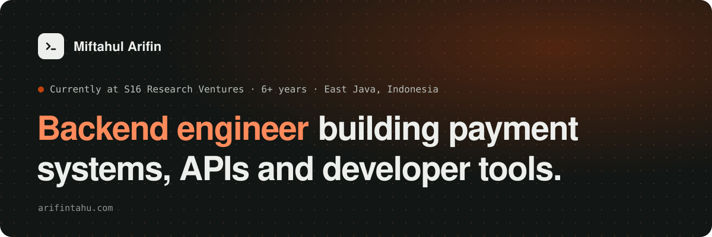

<a href="https://arifintahu.com"></a>

<p align="center">
  <a href="https://arifintahu.com">
    
  </a>
</p>

<p align="center">
  <a href="https://arifintahu.com"></a>
  <a href="mailto:miftahul97@gmail.com"></a>
  <a href="https://www.linkedin.com/in/miftahul-arifin/"></a>
  <a href="https://twitter.com/arifintahu"></a>
  <a href="https://t.me/arifintahu"></a>
</p>

### `$ whoami`

```ts
const arifin = {
  role: "Backend Engineer",
  at: "S16 Research Ventures",
  based: "East Java, Indonesia · UTC+7",
  experience: "6+ years",
  builds: ["payment systems", "APIs", "developer tools"],
  stack: ["C# / .NET", "Go", "TypeScript", "Rust", "Solidity", "Cosmos SDK"],
  // AI agents write more of my code every month, so I spend my time
  // where they can't be trusted alone:
  focus: ["system design", "security boundaries", "shipping safely"],
  writesAbout: ["payments", "smart-contract security", "cryptography", "how LLMs behave"],
};
```

### `$ ls ~/tools`

Each one started as a problem in my own week.

<p align="center">
  <a href="https://github.com/arifintahu/antlings"></a>
  <a href="https://github.com/emberterm/emberterm"></a>
  <a href="https://github.com/arifintahu/astral"></a>
  <a href="https://github.com/arifintahu/project-structure-api"></a>
  <a href="https://github.com/arifintahu/dexplorer"></a>
  <a href="https://github.com/arifintahu/xylem"></a>
</p>

Also: [Kawan](https://github.com/arifintahu/kawan-ai) · [PR Please](https://github.com/arifintahu/pr-please) · [Mobile Review MCP](https://github.com/arifintahu/mobile-review-mcp) · [QuickLend](https://github.com/arifintahu/quicklend) · [Vault Strategy](https://github.com/arifintahu/vault-strategy) · [Earn Aggregator](https://github.com/arifintahu/earn-aggregator) · **[all projects →](https://arifintahu.com/work)**

### `$ ls ~/writing`

<!-- BLOG-POST-LIST:START -->
- [Why cat bigfile freezes webview terminals: backpressure from ConPTY to xterm.js](https://arifintahu.com/writing/why-cat-bigfile-freezes-webview-terminals)
- [Gas sponsorship without draining your balance](https://arifintahu.com/writing/gas-sponsorship-without-draining-your-balance)
- [How ERC-4337 actually works: bundler, paymaster, entrypoint](https://arifintahu.com/writing/how-erc-4337-actually-works)
<!-- BLOG-POST-LIST:END -->

**[All articles →](https://arifintahu.com/writing)**

### `$ ls ~/stack`

<p align="center">
  
  <br>
  
</p>

### `$ git log --stat`

<p align="center">
  
  
</p>

<picture>
  <source media="(prefers-color-scheme: dark)" srcset="https://raw.githubusercontent.com/arifintahu/arifintahu/output/github-snake-dark.svg">
  <source media="(prefers-color-scheme: light)" srcset="https://raw.githubusercontent.com/arifintahu/arifintahu/output/github-snake.svg">
  
</picture>

---

<p align="center">
  <b>Building something that has to be reliable? <a href="mailto:miftahul97@gmail.com">Let's talk.</a></b>
  <br><br>
  
</p>
